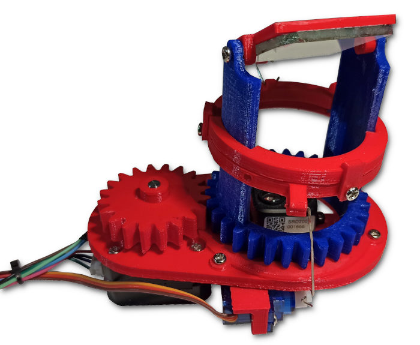

# 3D LiDAR Scanner MK2 — Build Files and Learning Reference

<p align="center">
  
</p>

<p align="center">
  <a href="#original-project-and-attribution">Original project</a> ·
  <a href="#what-is-in-this-repository">Source files</a> ·
  <a href="#getting-started">Getting started</a> ·
  <a href="#bill-of-materials">Bill of materials</a> ·
  <a href="LICENSE">License</a>
</p>

**An educational hardware project combining a rotating time-of-flight distance sensor, an STM32F103 controller, mechanical scanning parts, and a Processing 3D point-cloud viewer.**

> [!IMPORTANT]
> **This is a repackaged collection of files from [Charles Grassin's 3D LiDAR Scanner MK2](https://github.com/CGrassin/3d_lidar), not an independently designed LiDAR scanner.** The original firmware, viewer, circuit diagram, SolidWorks model, STL parts and project photo were compared with the upstream files and are byte-for-byte identical. The original author's license and copyright notice are retained. This repository adds a reorganized layout and build-oriented documentation.

## Original project and attribution

- **Original author and designer:** [Charles Grassin](https://github.com/CGrassin)
- **Original repository:** https://github.com/CGrassin/3d_lidar
- **Original build article:** http://charleslabs.fr/en/project-3D+Lidar+Scanner+MK2
- **Upstream license:** [MIT, copyright © 2020 Charles Grassin](https://github.com/CGrassin/3d_lidar/blob/main/LICENSE)
- **This repository:** Reorganized learning/reference copy maintained by Sai Tanveesh; **no independent claim of authorship** for the original hardware design, firmware or Processing viewer.

See [CREDITS.md](CREDITS.md) for the source-file attribution mapping.

## What it does

The project uses a TF-Luna/TF-Mini-style serial time-of-flight sensor and mechanical motion to acquire distance samples over changing angles. STM32 firmware converts readings into approximate XYZ coordinates, then streams tab-delimited values over serial to a Processing application for interactive 3D point-cloud display.

```text
TF-Luna / ToF sensor
         |
         | Serial3, 115200 baud
         v
   STM32F103 controller <----- stepper + two servos
         |
         | USB/serial, 115200 baud
         | X TAB Y TAB Z TAB strength
         v
 Processing LidarViewer
         |
         +----- 3D point-cloud display / text export
```

This architecture is a useful learning reference for embedded sensor acquisition, geometry, motor control and 3D visualization. The repository does **not** include independent calibration, accuracy or field-test reports for the hardware.

## What is in this repository?

| Path | Contents | Provenance |
|---|---|---|
| [`Ardunio Code/STM32.ino`](Ardunio%20Code/STM32.ino) | STM32 scanner firmware | Original Charles Grassin firmware, unchanged |
| [`Processing Code/Lidar Viewer/LidarViewer.pde`](Processing%20Code/Lidar%20Viewer/LidarViewer.pde) | 3D point-cloud viewer | Original Charles Grassin Processing sketch, unchanged |
| [`CIrcuit/Circuit.png`](CIrcuit/Circuit.png) | Wiring/electronics schematic | Original Charles Grassin diagram, unchanged |
| [`SLDPTR/Lidar.SLDPRT`](SLDPTR/Lidar.SLDPRT) | Native SolidWorks part | Original Charles Grassin CAD part, unchanged |
| [`STL/Files/`](STL/Files/) | Nine 3D-printable model files | Original Charles Grassin STLs, unchanged |
| [`Picture.jpg`](Picture.jpg) | Project photograph | Original Charles Grassin photo, unchanged |

The directory names `Ardunio Code`, `CIrcuit`, and `SLDPTR` retain the spelling used in this repository so existing paths continue to work.

## Getting started

### 1. Inspect the design

Read [the original build article](http://charleslabs.fr/en/project-3D+Lidar+Scanner+MK2), the supplied circuit diagram and the STL models before buying parts or wiring anything.

**Software:** Arduino IDE with a suitable STM32 core, Processing IDE with the **PeasyCam** library, a driver for your USB/serial interface, and optionally a slicer and SolidWorks-compatible CAD viewer.

### 2. Review the wiring and firmware

Open `Ardunio Code/STM32.ino` in the Arduino IDE. The preserved sketch currently declares:

| Function | Firmware pin/interface |
|---|---|
| Stepper STEP | `PA8` |
| Stepper DIR | `PB15` |
| Servo G | `PB0` |
| Servo D | `PB1` |
| Distance sensor | `Serial3` at 115200 baud |
| External serial | `Serial` at 115200 baud |

Confirm the **specific STM32F103 board pin mapping, motor-driver wiring, power domains and voltage limits** against the upstream schematic and datasheets. This repository has not independently validated all hardware combinations; do not connect a stepper motor directly to MCU pins.

### 3. View point clouds

Open `Processing Code/Lidar Viewer/LidarViewer.pde` in the Processing IDE. Install PeasyCam via **Sketch → Import Library → Add Library** and search for **PeasyCam**. Run the sketch and select the correct serial interface.

The sketch expects a serial line with **four tab-separated values**: X, Y, Z and signal strength. It displays the coordinates as a point cloud. Press **S** to export coordinates to a text file or **X** to clear the view.

### 4. Fabricate mechanical parts

Browse [`STL/Files/`](STL/Files/) for the nine printable components and [`SLDPTR/`](SLDPTR/) for the native CAD source. Review the original build article for mechanical assembly, mirror orientation, coupling and clearance.

## Bill of materials

This table preserves the approximate **historical INR figures previously listed in this repository**. They are **not current retailer quotes** and quantities/prices should be verified before purchasing.

| Qty | Component | Previously listed line cost |
|---:|---|---:|
| 1 | STM32F103 Blue Pill board | ₹189 |
| 1 | TF-Luna LiDAR distance sensor | ₹2,350 |
| 1 | DRV8825 stepper driver | ₹85 |
| 1 | 17HS4023 stepper motor | ₹690 |
| 2 | SG90 mini servos | ₹245 |
| 1 | Mini 360 DC-DC buck converter | ₹95 |
| 1 | USB-to-UART interface | ₹95 |
| 15 | M3 × 6 mm screws | ₹189 |
| 2 | M2.5 screws | ₹95 |
| 1 | 40 × 40 mm mirror | ₹50 |
| 1 | Solderless breadboard | ₹95 |
| — | PLA filament (~100 g) | ₹280 |
| | **Sum of the listed line items** | **₹4,458** |

The previous README incorrectly listed a **₹4,758** total and also mentioned **₹3,700**. The sum above corrects the arithmetic only; it does not establish contemporary pricing or availability.

## Measurement and safety notes

- A 2400-step-per-revolution motion parameter describes the **motor pulse configuration**, not measured LiDAR angular point-cloud resolution.
- TF-Luna measurement range and precision depend on the sensor's specifications, reflectance, target geometry and operating conditions.
- Scanner geometry includes approximations; verify angular calibration and distance offsets before using exported coordinates quantitatively.
- Use proper stepper power supplies and motor drivers; confirm grounds, voltage compatibility, current limits and mechanical clearance before energizing a prototype.
- Do not use this experimental scanner as a safety-critical obstacle-detection system.

## License and contributions

The upstream project is MIT-licensed. This copy preserves **Charles Grassin's 2020 copyright notice**; new original documentation is attributed separately to Sai Tanveesh. Read the full [LICENSE](LICENSE) and [CREDITS.md](CREDITS.md).

If you adapt the design, preserve the upstream notice and clearly identify what your modified files change. Contributions that improve build instructions, add reproducible test measurements or fix documentation are welcome, provided they respect upstream attribution.
